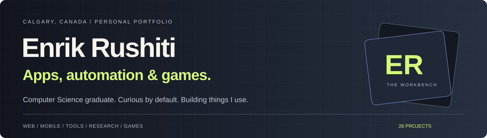
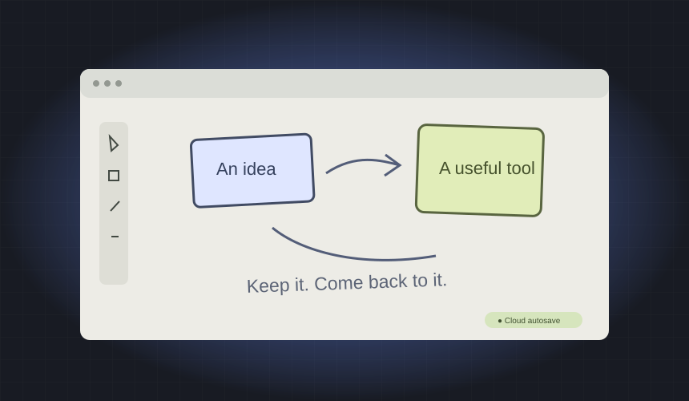
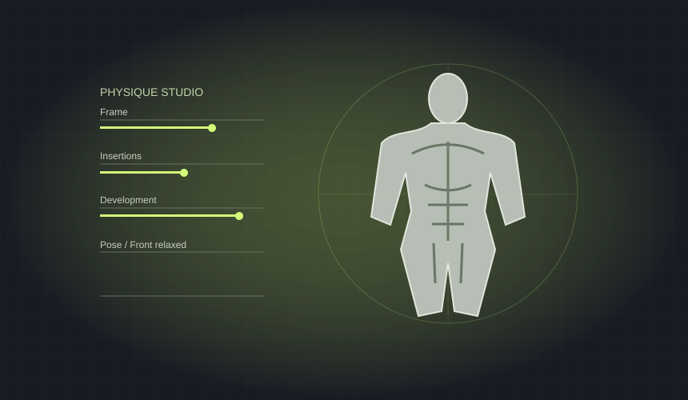
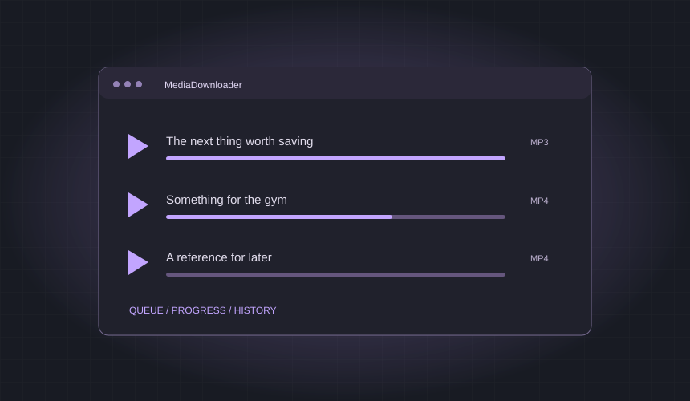
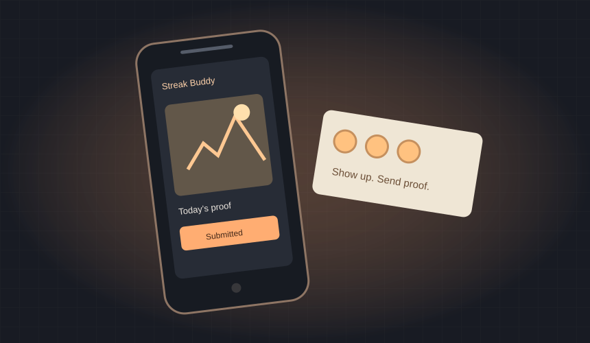
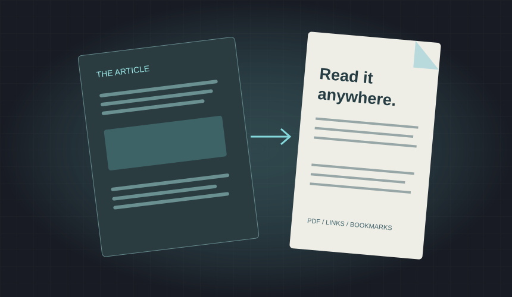
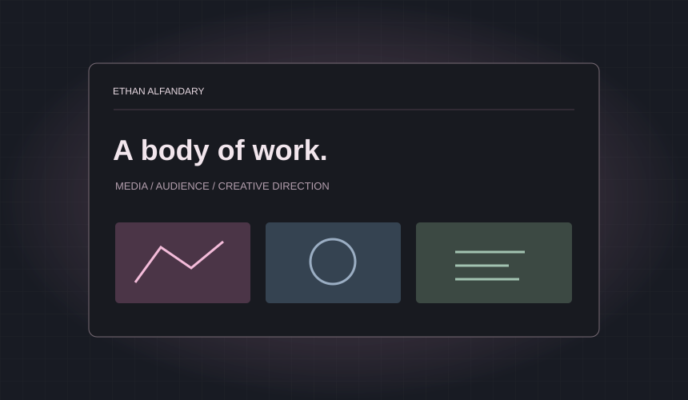

<!-- Generated from portfolio.json by scripts/build.mjs. -->

<a href="#featured-builds"><strong>Featured builds</strong></a> · <a href="#the-full-project-index">Project index</a> · <a href="#background">Background</a> · <a href="https://www.linkedin.com/in/enrik-rushiti-62520a255/">LinkedIn</a>

I’m **Enrik**, a Computer Science graduate in Calgary. I build web and mobile apps, useful automations, research systems, and games with friends. A lot of it starts with a problem I want solved in my own life.

**26 projects · 6 featured builds · 11 public source repositories**

## Featured builds

<table>
<tr><td width="50%" valign="top"><h3>01 · EnrikDraw</h3>
Cloud persistence for Excalidraw, right inside Notion.

<strong>Next.js · TypeScript · Supabase Postgres · Excalidraw</strong>

<a href="https://github.com/EnrikR2002/EnrikDraw">Explore the project ↗</a>
</td><td width="50%" valign="top"><h3>02 · Insertion Physique Studio</h3>
A 3D studio for physique traits, poses, and comparisons.

<strong>JavaScript · Three.js · Vite · Blender asset tools</strong>

<a href="https://github.com/EnrikR2002/Bodybuilding-Genetics-Simulator">Explore the project ↗</a>
</td></tr>
<tr><td width="50%" valign="top"><h3>03 · MediaDownloader</h3>
A desktop tool for batch downloads and MP3/MP4 conversion.

<strong>Python · CustomTkinter · yt-dlp · FFmpeg</strong>

Private source · project overview below
</td><td width="50%" valign="top"><h3>04 · Streak Buddy</h3>
Photo proof, friend reviews, and daily streaks.

<strong>React Native · Expo · Firebase Auth · Firestore</strong>

Private source · project overview below
</td></tr>
<tr><td width="50%" valign="top"><h3>05 · Article to PDF</h3>
Substack and X articles turned into readable PDFs.

<strong>Next.js · TypeScript · PDFKit · Unicode fonts</strong>

<a href="https://github.com/EnrikR2002/Substack-and-X-Articles-to-PDF">Explore the project ↗</a>
</td><td width="50%" valign="top"><h3>06 · Ethan Portfolio Website</h3>
A portfolio for media, audience growth, and creative direction.

<strong>Astro · TypeScript · Tailwind CSS</strong>

<a href="https://github.com/EnrikR2002/ethan-site">Explore the project ↗</a>
</td></tr>
</table>

## Recent work

- **Picard Performance Platform** — coach dashboard and mobile app foundation, with authentication, role-based access, shared packages, and database security.
- **Loot Goblins & Don’t Touch That** — Roblox prototypes with Ethan and Ninety; shared source, playtests, and a repeatable development setup.
- **StreakPet** — a Whop community app with daily check-ins, evolving pet stages, reminders, and growth entitlements.
- **Web of Shadows DS tooling** — archive extraction, rebuild verification, versioned patches, and emulator research.

## The full project index

### Web applications

| Project | What it does | Stage |
| :--- | :--- | :--- |
| [EnrikDraw](https://github.com/EnrikR2002/EnrikDraw) | Adds cloud document storage and autosave to Excalidraw drawings that remain editable inside Notion embeds. | Built |
| [Insertion Physique Studio](https://github.com/EnrikR2002/Bodybuilding-Genetics-Simulator) | Interactive 3D physique studio for exploring muscle insertions, skeletal proportions, development, poses, and body measurements. | Built |
| [Article to PDF](https://github.com/EnrikR2002/Substack-and-X-Articles-to-PDF) | Converts Substack posts, X posts, and X articles into offline PDFs with links, images, structured formatting, and bookmarks. | Built |
| [Ethan Portfolio Website](https://github.com/EnrikR2002/ethan-site) | Portfolio website for Ethan Alfandary showcasing audience growth, media systems, and creative work. | Built |
| **Picard Performance Platform** | Coaching platform foundation with a coach web dashboard, role-aware mobile app, shared packages, and database security. | Foundation · Private source |
| **StreakPet** | Whop community streak app with an evolving pet dragon, daily check-ins, leaderboards, reminders, and member growth entitlements. | Built · Private source |

### Mobile applications

| Project | What it does | Stage |
| :--- | :--- | :--- |
| **Streak Buddy** | Habit accountability app with photo proof, buddy review, time-zone-aware streaks, reminders, and live leaderboards. | Built · Private source |
| **Furry Land Customer App** | Mobile dog-grooming prototype with pet profiles, a seven-step booking flow, appointment management, and payment UI. | Prototype · Private source |

### Automation and data tools

| Project | What it does | Stage |
| :--- | :--- | :--- |
| **MediaDownloader** | Desktop media downloader with MP3/MP4 conversion, a managed queue, progress display, settings, and download history. | Built · Private source |
| **Instagram Reels Metadata Scraper** | Extracts accessible Reel metadata through a CLI, browser dashboard, and Windows launcher, with caching and optional thumbnail OCR. | Built · Private source |
| **n8n and Oracle Automation Infrastructure** | Oracle VM provisioning and HTTPS self-hosted n8n infrastructure, with workflow and WorkJam session support. | Tooling · Private source |
| **WorkJam to Google Calendar** | Syncs WorkJam shifts to a dedicated Google Calendar, updating changed events and removing cancelled shifts it manages. | Built · Private source |
| [X Bookmarks Discord Digest](https://github.com/EnrikR2002/X-Bookmarks) | Turns X bookmarks into categorized Discord digests and actionable follow-ups, with caching, scheduling, and per-user authentication. | Built |
| **YouTube Metadata Extractor** | Web tool extracting video metadata, thumbnails with OCR, timestamped transcripts, and spreadsheet-ready output. | Built · Private source |

### Research systems

| Project | What it does | Stage |
| :--- | :--- | :--- |
| **SYFER 15 Minute BTC Research** | 15-minute BTC prediction-market research system with data capture, paper execution, settlement analysis, and strategy diagnostics. | Research · Private source |
| **SYFER BTC Dashboard and Research** | BTC prediction-market infrastructure with streaming data, strategy evaluation, execution/risk tooling, dashboard, and settlement research. | Research · Private source |
| **SYFER Weather Market Research** | Temperature-market research platform with multi-venue adapters, data collection, paper broker, execution diagnostics, and dashboard. | Research · Private source |
| [Weather Signal Discord Bot](https://github.com/EnrikR2002/Polymarket-Weather-Bot) | Early weather prediction-market signal bot with forecast ingestion, scheduled Discord cards, outcome resolution, and session reporting. | Research |

### Games

| Project | What it does | Stage |
| :--- | :--- | :--- |
| **Don't Touch That** | Team Roblox chaos game prototype where forbidden objects reward the player and trigger hazards for everyone. | Prototype · Private source |
| [Loot Goblins](https://github.com/EnrikR2002/Loot-Goblins) | Team Roblox raid prototype centered on stealing loot, world reactions, contested carrying, escape, and banking rewards. | Prototype |

### Development tooling

| Project | What it does | Stage |
| :--- | :--- | :--- |
| **Roblox Game Development Template** | Reusable team scaffolding for Roblox projects with pinned tools, CI, onboarding docs, and one-click launchers. | Tooling · Private source |
| **Web of Shadows DS Modding Tools** | Private game-modding research with extraction/rebuild tools, round-trip checks, versioned patches, and emulator playtest workflows. | Research · Private source |

### University projects

| Project | What it does | Stage |
| :--- | :--- | :--- |
| [Art Gallery REST API](https://github.com/EnrikR2002/3612Assignment3) | REST API for paintings, artists, and galleries, including filters by country, artist, gallery, year, title, and color. | Coursework |
| [Daily Planner Across Programming Paradigms](https://github.com/nbrar891/COMP-3649-Assignment) | Team daily-planner assignment solving activity scheduling in imperative and declarative programming styles. | Coursework |
| [GrimeWire Music Explorer](https://github.com/EnrikR2002/3612Assignment2) | Song browser with title, artist, and genre filters, playlist controls, and song-detail visualizations. | Coursework |
| [Travel Destination Website](https://github.com/EnrikR2002/3612-assignment-1) | Multi-page travel website with destination cards, navigation, images, and shared styling. | Coursework |

Private source means the implementation repository is private; the project description remains part of this portfolio. Prototypes and research are labelled by their current stage. Trading research is presented for its engineering and experiments, without a claim of proven profitability.

## Things I build with

**Languages** — Python · TypeScript · JavaScript · SQL · Java · C/C++ · Luau  
**Apps** — React Native · Expo · Next.js · Astro · Three.js  
**Data & infrastructure** — Supabase · Firebase · SQLite · FastAPI · Docker · Oracle Cloud · n8n  
**Workflow** — Git/GitHub · automated checks · AI-assisted development · documentation that keeps projects understandable

## Background

| Experience | Focus |
| :--- | :--- |
| **IT Technician · Electronic Recycling Association** Apr 2026–present | Hardware diagnostics, refurbishment, system imaging, and device lifecycle management. |
| **Data Analyst Intern · Suncor Energy** Sep 2023–Aug 2024 | Data validation, schema work, cross-functional coordination, and communicating findings to stakeholders. |
| **BSc Computer Science · Mount Royal University** 2020–2025 | GIS cognate; President’s and Dean’s Honor Roll. |

## Beyond the code

Natural bodybuilding, bioenergetics, and philosophy. I like understanding how things work, finding something worth improving, and making the improvement concrete. Those interests show up in the software too.

## Get in touch

**[LinkedIn](https://www.linkedin.com/in/enrik-rushiti-62520a255/)** · **[GitHub](https://github.com/EnrikR2002)** · **Discord: `frikienriki`**

The full website is built alongside this profile. [Browse the portfolio source](docs/) or [see how the two stay connected](MAINTAINING.md).
